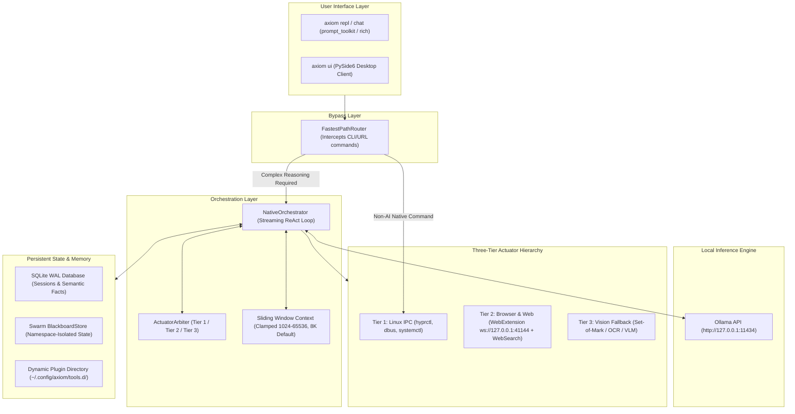
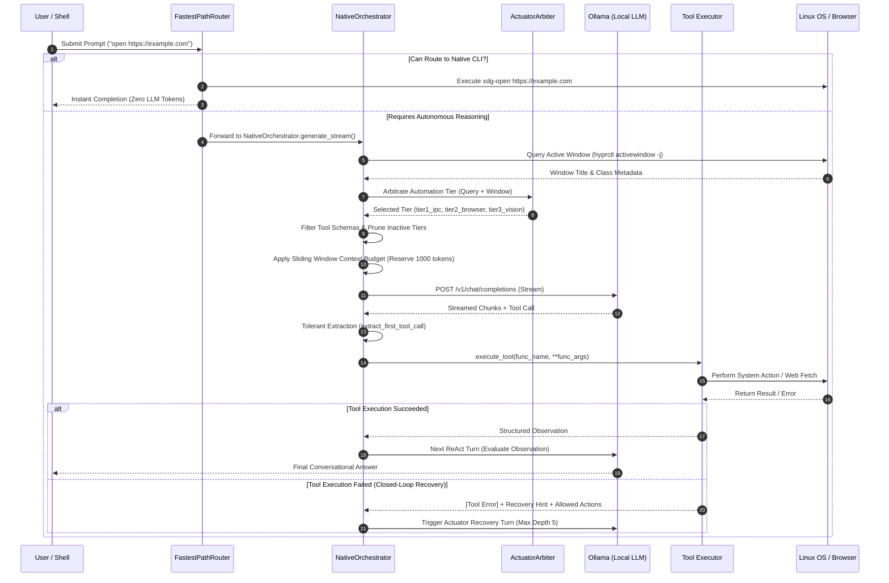

# AXIOM Architecture & Execution Flow Specification

This document specifies the runtime architecture, request lifecycle, context budgeting, and tool routing mechanisms in **AXIOM** (v1.0.0).  
All architecture claims are grounded in verified source code and reproducible automated tests.

---

## 1. System Topology Overview

AXIOM is a local-first AI operating system engineered for Linux (specifically Wayland compositors such as Hyprland). It decouples user interfaces, background daemons, local LLM inference engines, and OS actuators:



---

## 2. Request Lifecycle & Execution Flow `[VERIFIED]`

When a user submits a prompt via [`axiom.cli.repl`](../axiom/cli/repl.py), [`axiom.cli.tui`](../axiom/cli/tui.py), or [`axiom.gui.app`](../axiom/gui/app.py), the execution follows a deterministic, 10-step lifecycle:



### Step-by-Step Breakdown:

1. **Fast-Path Interception ([`axiom/core/fast_path_router.py`](../axiom/core/fast_path_router.py)):**  
   Evaluates proposed actions against regex patterns and known binary maps (`KNOWN_APP_BINARIES`). Standard actions like launching apps (`open terminal`), navigating URLs (`open https://...`), or restarting systemd units are routed directly to native CLI commands (`kitty`, `xdg-open`, `systemctl`) in sub-10ms with zero model tokens expended.
2. **Window Context Introspection ([`axiom/agents/native_orchestrator.py`](../axiom/agents/native_orchestrator.py#L82-L134)):**  
   Non-blockingly queries `hyprctl activewindow -j` (0.5s timeout). Prepend telemetry headers:  
   `[Active Window: title="...", class="...", workspace=1]` to the initial user turn.
3. **Actuator Tier Arbitration ([`axiom/agents/actuator_arbiter.py`](../axiom/agents/actuator_arbiter.py)):**  
   Evaluates query intent and window context to select one of:
   - `tier1_ipc`: Window, process, clipboard, journal, volume, or network commands.
   - `tier2_browser`: Active browser windows, URLs, web searches, or DOM interactions.
   - `tier3_vision`: Non-accessible canvas applications, legacy games, or general UI fallback.
4. **Tool Schema Filtering ([`axiom/core/plugins.py`](../axiom/core/plugins.py#L598-L630)):**  
   Prunes unneeded schemas from the LLM prompt. Tier 1 queries expose only 9 core and OS tools; Tier 2 queries expose 5 core and web tools.
5. **Strict Negative Gating:**  
   If an active browser window is focused, [`axiom/core/plugins.py`](../axiom/core/plugins.py#L626-L627) strictly purges Tier 3 generic desktop vision tools (`interact_with_ui`) to prevent the model from guessing pixel coordinates on interactive web pages.
6. **Sliding-Window Context Pruning ([`axiom/agents/native_orchestrator.py`](../axiom/agents/native_orchestrator.py#L167-L208)):**  
   Enforces a sliding window keeping system directives, the first user prompt, and the most recent conversation turns within `max_context_tokens - 1000` tokens.
7. **Model Event Streaming ([`axiom/agents/native_orchestrator.py`](../axiom/agents/native_orchestrator.py#L381-L450)):**  
   Streams responses from Ollama over HTTP (`/v1/chat/completions`). Supports reasoning models by extracting `<think>` tags and streaming reasoning traces.
8. **Tolerant Tool Call Extraction ([`axiom/agents/native_orchestrator.py`](../axiom/agents/native_orchestrator.py#L224-L380)):**  
   Smaller local models (e.g., Qwen-7B) often emit concatenated JSON, markdown blocks, or reasoning text before tool invocations. The extractor parses raw text iteratively using `json.JSONDecoder().raw_decode` starting at candidate `{` tokens.
9. **Bounded Execution & Timeouts:**  
   Tools are executed with tier-specific timeouts (Tier 1: 10s–30s; Tier 2: 10s; Tier 3 Vision: 35s). Timeouts raise structured recovery hints instead of crashing the loop.
10. **Closed-Loop Error Recovery:**  
    If a tool fails, the error message and remedy hint (`[Tool Error]: ... Recovery Hint: ...`) are fed into the next turn. Conversational excuses are blocked, forcing the model to invoke the recovery tool directly.

---

## 3. The Three-Tier Actuator Model `[VERIFIED]`

Workstation automation is partitioned into three tiers to guarantee precision and avoid hallucinated mouse clicks:

| Tier | Subsystem | Verified Backing Tools | Latency | Precedence |
| :--- | :--- | :--- | :---: | :---: |
| **Tier 1** | **Deterministic IPC & Linux OS** | `manage_desktop_window`, `manage_system_process`, `manage_system_clipboard`, `query_system_journal`, `manage_media_playback`, `manage_workspace_file`, `send_desktop_notification`, `inspect_network`, `execute_command` | < 50ms | **Highest** |
| **Tier 2** | **Semantic Browser DOM & Web Search** | `interact_with_browser` (WebExtension WebSocket bridge at `ws://127.0.0.1:41144`), `web_search`, `fetch_web_page` | 100–300ms | **Intermediate** |
| **Tier 3** | **Visual Grounding Fallback** | `interact_with_ui`, Set-of-Mark (SoM) bounding boxes, OCR, and VLM click coordinates | 1000–3000ms | **Lowest** (Fallback) |

---

## 4. Context Budgeting & Sliding Window Algorithm `[VERIFIED]`

### A. Authoritative Precedence Hierarchy

The context token budget (`max_context_tokens`) is resolved dynamically with strict 4-level precedence:

```
[1. Explicit Caller Override]
          │ (e.g., caller_override=32768 in NativeOrchestrator payload)
          ▼
[2. Environment Variable]
          │ (AXIOM_NUM_CTX="16384")
          ▼
[3. User Configuration File]
          │ ("ollama_num_ctx": 8192 in ~/.config/axiom/config.json)
          ▼
[4. System Default Fallback]
            (8,192 tokens)
```

### B. Context Validation & Clamping (`validate_and_clamp_num_ctx`)

- **Valid Range:** `[1024, 65536]`.
- Non-integers, booleans, negative numbers, or values outside `[1024, 65536]` log a warning and fall back to `8192`.
- Prevents GPU VRAM exhaustion on consumer hardware (e.g., RTX 4060 8GB).

### C. Sliding Window Message Pruning (`prune_messages`)

When total message tokens exceed `max_context_tokens - 1000`:
1. System directives are always retained.
2. The initial conversation turn (`conv_messages[0]`) is always retained to preserve original intent.
3. Older intermediate turns are dropped while the newest turns are retained up to the token budget.

---

## 5. Swarm Blackboard & Distributed Memory `[VERIFIED]`

The multi-agent swarm architecture uses an isolated blackboard store for inter-agent collaboration:

- **`BlackboardStore` ([`axiom/memory/blackboard.py`](../axiom/memory/blackboard.py)):**  
  Manages key-value state indexed by `session_id` and `agent_id`.
- **Namespace Isolation:**  
  Agents inside the same session cannot read or overwrite another agent's private keys unless shared via explicit consensus proposals.
- **Session Isolation:**  
  Concurrent sessions are completely isolated in memory.
- **Transaction Rollback:**  
  [`axiom/core/transaction.py`](../axiom/core/transaction.py) coordinates with `BlackboardStore`. Rolling back a transaction automatically purges associated blackboard state.

---

## 6. Dual-Orchestrator Comparison `[VERIFIED]`

The repository contains two orchestrator implementations serving distinct operational roles:

| Dimension | `NativeOrchestrator` ([`axiom/agents/native_orchestrator.py`](../axiom/agents/native_orchestrator.py)) | `OrchestratorAgent` ([`axiom/agents/orchestrator_agent.py`](../axiom/agents/orchestrator_agent.py)) |
| :--- | :--- | :--- |
| **Status** | **[VERIFIED] Active production CLI engine** | **[PARTIALLY VERIFIED] Extended state-machine engine** |
| **Entry Point** | Used by `axiom`, `axiom repl`, `axiom chat` | Used by multi-agent swarm services |
| **Execution Loop** | Lightweight streaming async generator (`generate_stream`) | Explicit state machine (`THINK`, `ACT`, `OBSERVE`, `REFLECT`) |
| **Context Management** | Dynamic sliding-window pruning (`prune_messages`) | `ContextManager` token estimation |
| **Tool Loading** | Dynamic plugins via `axiom.core.plugins` | Static registry via `axiom.engine.tool_pruner` |
| **Ollama Communication**| Direct HTTP/SSE stream with `<think>` tag extraction | `SmartRouter` / `LiteLLM` abstraction |
